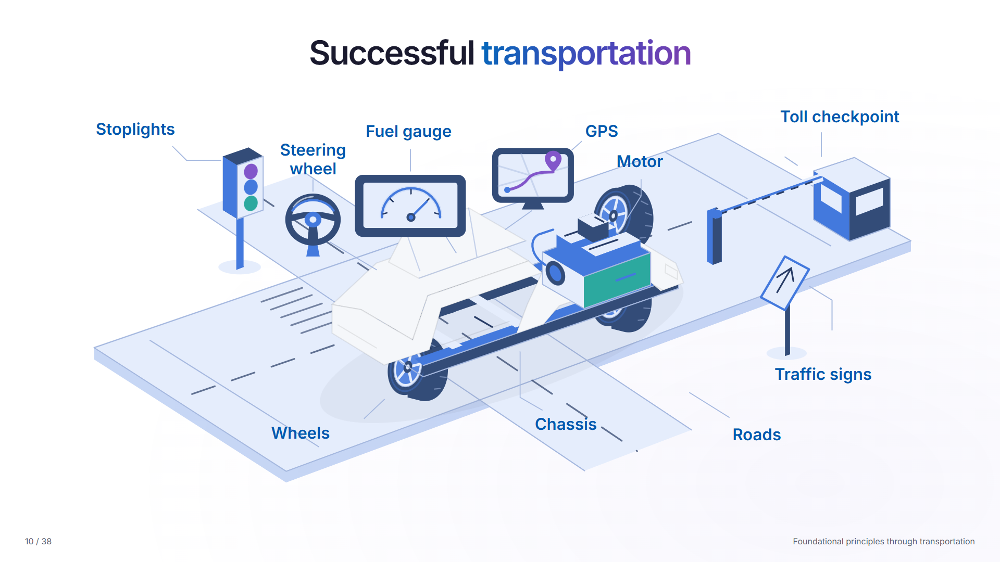
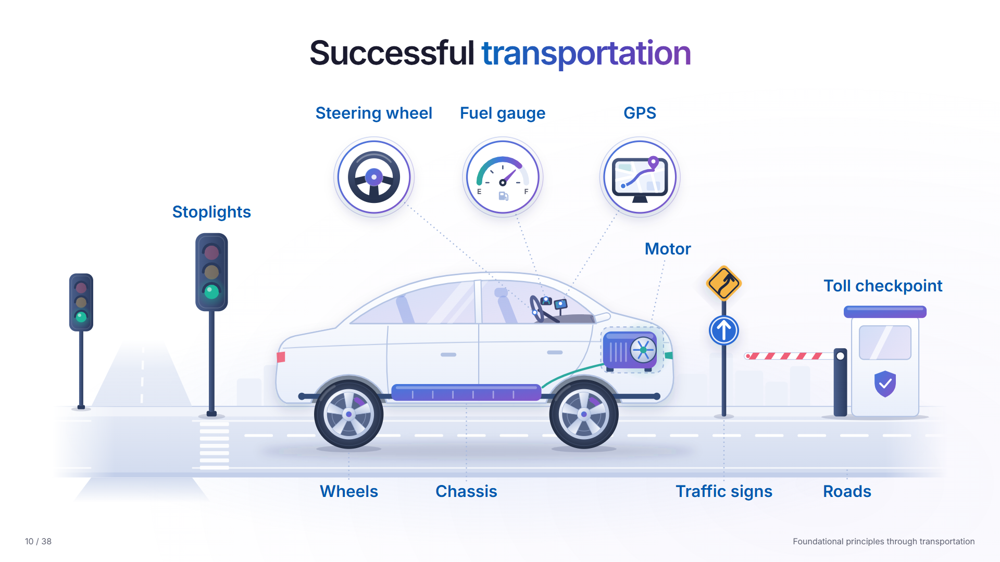

# Transportation slide: before and after

Slide 10 of the [Microsoft AI ecosystem presentation](https://miguelmodel.github.io/20261102_Microsoft_AI_ecosystem_public/), redrawn in build v11. The ten parts, labels and click order stay the same; only the drawing changed.

## Before (build v10)

## After (build v11)

